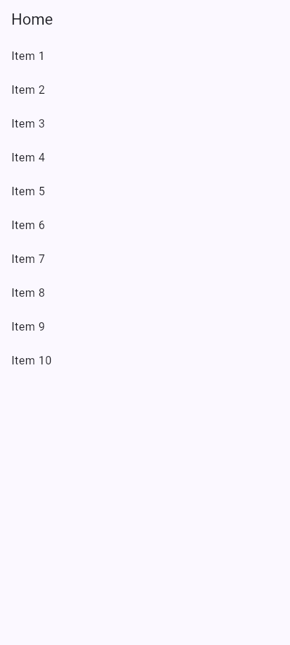
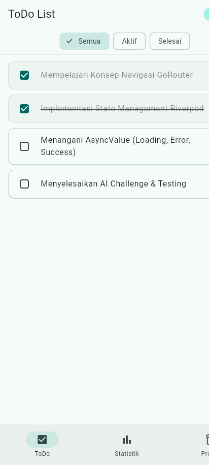
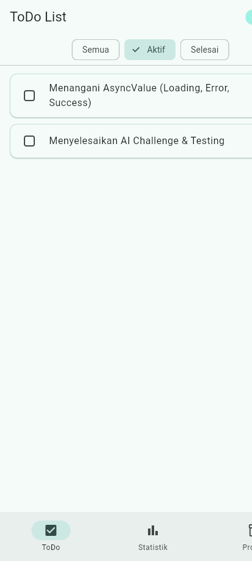
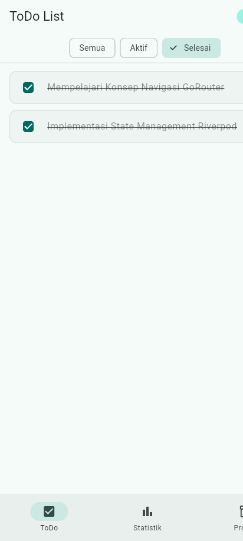
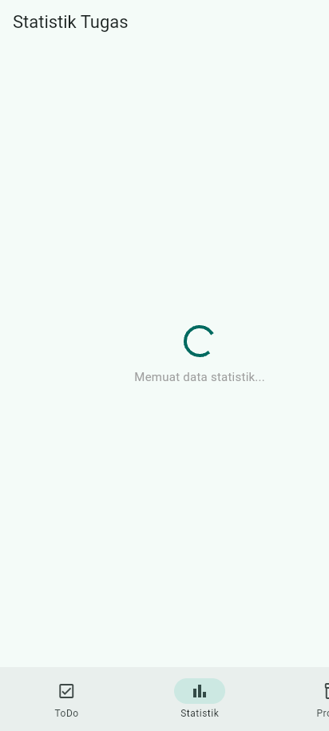
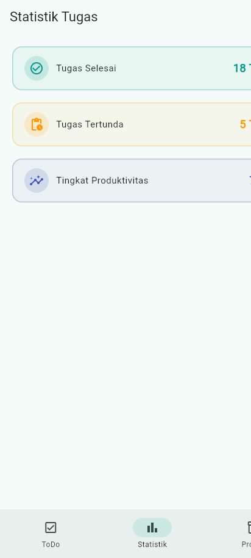
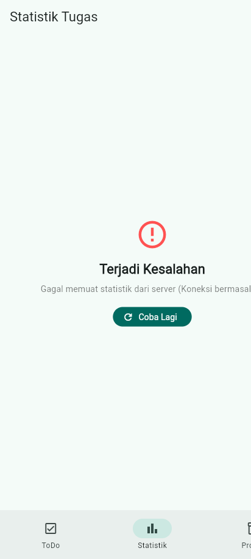
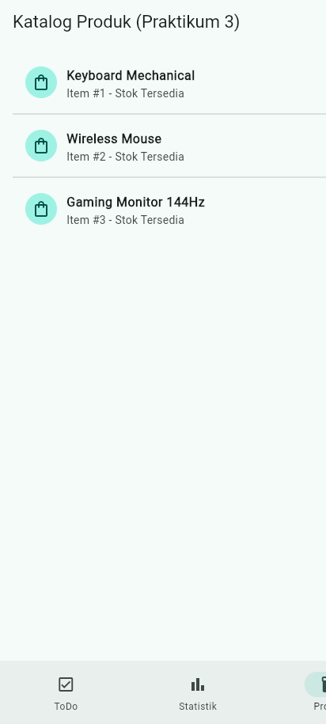

# 📋 Week 3: Navigation & State Management

## Identitas Mahasiswa

| Aspek | Keterangan |
|---|---|
| **Nama** | Amin Aziz Sudjud |
| **NIM** | 244107020079 |
| **Kelas** | TI-3D |
| **Mata Kuliah** | Pemrograman Mobile (Semester 5) |
| **Topik Modul** | #03 - Navigation & State Management (GoRouter & Riverpod) |

---

## 1. Ringkasan & Konteks Pembelajaran (Korelasi Week 1, 2, dan 3)

Pada **Week 1**, saya telah mempelajari ekosistem dasar Flutter, cara kerja *widget tree*, serta paradigma dasar UI deklaratif di mana antarmuka pengguna merupakan fungsi dari state (`UI = f(state)`). Karena kendala instalasi Android Studio pada perangkat lokal, saya menggunakan target browser **Chrome (Web)** dan desktop yang ringan dan stabil sebagai lingkungan eksekusi utama.

Pada **Week 2**, pemahaman diperdalam ke **Declarative UI & Responsive Design** menggunakan `LayoutBuilder`, `GridView`, penerapan token warna dinamis berbasis `Theme.of(context)`, aksesibilitas `Semantics`, serta pembiasaan melakukan refactoring dengan mengekstrak widget reusable (seperti `InfoCard`) dan memverifikasi kode melalui widget test.

Pada **Week 3** ini, aplikasi melangkah ke arsitektur berskala menengah yang lebih modular dengan menyelesaikan dua tantangan terbesar pada aplikasi mobile:
1. **Navigasi Deklaratif**: Mengganti navigasi imperatif `Navigator 1.0` (`Navigator.push/pop`) yang rawan *tight coupling* dengan **GoRouter**, router deklaratif berbasis URL/path parameter dan shell route.
2. **Global State Management**: Mengatasi keterbatasan `setState` lokal dan masalah *prop drilling* menggunakan **Riverpod 2/3**. Memisahkan state bisnis keluar dari widget tree menggunakan `Notifier` dan `AsyncNotifier`, menjaga *immutability* objek model, serta mengelola siklus data asinkron secara aman melalui `AsyncValue`.

---

## 2. Praktikum 1 — Aplikasi Multi-Page dengan GoRouter (`week3_navigation`)

### Konsep Navigasi: Navigator 1.0 vs GoRouter
- **Navigator 1.0 (Imperatif)**: Layar ditumpuk manual di atas stack (`Navigator.push(context, MaterialPageRoute(...))`). Pada aplikasi yang kompleks, rute menjadi sulit dipetakan, penanganan deep linking rumit, dan *navigation guard* (seperti autentikasi) tersebar di berbagai callback.
- **GoRouter (Deklaratif)**: Rute dideklarasikan secara terpusat (`GoRoute`) berbasis path URL (misalnya `/`, `/detail/:id`). Mendukung *path parameters*, *query parameters*, deep linking terstruktur, serta navigasi langsung menggunakan `context.go()` atau `context.push()`.

### Struktur File:
```
week3_navigation/
├── lib/
│   ├── main.dart             # Konfigurasi GoRouter (_router) dan MaterialApp.router
│   └── pages/
│       ├── home_page.dart    # Daftar 10 item dengan ListTile dan context.go('/detail/${index + 1}')
│       └── detail_page.dart  # Layar detail menerima state.pathParameters['id']
└── test/
    └── widget_test.dart      # Widget test otomatis verifikasi navigasi GoRouter
```

### Hasil Eksekusi Praktikum 1:
- `flutter test` berjalan sukses dan memverifikasi perpindahan dari HomePage ke DetailPage dengan argument path parameter.
- `flutter analyze` menghasilkan **0 issues**.

---

## 3. Praktikum 2 — Aplikasi ToDo dengan Riverpod (`week3_todo`)

### Mengapa State Management Diperlukan?
Ketika state hanya dibutuhkan oleh satu widget lokal (misal controller animasi atau input sementara), `setState` sudah mencukupi. Namun, jika state harus dibagi antar banyak layar (misal daftar ToDo yang ditampilkan di halaman beranda dan status ringkasannya dibutuhkan di halaman statistik), menaruh state di widget induk teratas memicu **prop drilling** dan membuat widget tree kotor.

Riverpod memindahkan state ke luar widget tree sehingga:
- UI dibangun ulang secara deterministik dan reaktif.
- Logika bisnis dapat diuji secara independen melalui *Unit Testing* tanpa ketergantungan pada `BuildContext`.
- State tetap hidup (*persisted*) meskipun widget sedang tidak tampil di layar.

### Konsep Inti Riverpod yang Diterapkan:
1. **`ProviderScope`**: Membungkus root widget aplikasi (`MyApp`) sebagai penampung global semua provider.
2. **`Todo` (Immutable Model)**: Model data yang tidak dapat diubah langsung, menyediakan method `copyWith` untuk menghasilkan salinan baru saat nilai berubah.
3. **`TodoListNotifier` (`Notifier<List<Todo>>`)**: Mengelola daftar ToDo secara immutable melalui method `add`, `toggle`, dan `remove`. Tidak pernah memutasi `state` secara langsung (`state.add()`), melainkan selalu membuat list baru:
   ```dart
   void add(String title) => state = [...state, Todo(title)];
   void remove(int index) => state = [...state]..removeAt(index);
   ```
4. **`ConsumerWidget` & `WidgetRef`**: Widget membaca provider menggunakan `ref.watch(todoListProvider)` di dalam method `build` (untuk mendengarkan perubahan), serta menggunakan `ref.read(todoListProvider.notifier)` di dalam callback event (seperti tombol ditekan).

---

## 4. Praktikum 3 — Asynchronous State Management dengan `AsyncValue`

### Masalah Pola Tradisional vs Keunggulan `AsyncValue`
Pada penanganan proses asinkron biasa (seperti HTTP Request / Database), developer sering memakai tiga variabel boolean terpisah:
```dart
bool isLoading = false;
bool hasError = false;
String? errorMessage;
List<T>? data;
```
Pendekatan ini rawan bug karena developer bisa lupa me-reset salah satu flag (misal `isLoading == true` bersamaan dengan `hasError == true`).

Riverpod memecahkan masalah ini dengan **`AsyncValue<T>`** yang menggabungkan ketiga kondisi menjadi tipe mutlak yang saling eksklusif:
- `AsyncLoading`: proses pengambilan data sedang berlangsung.
- `AsyncError`: proses gagal dan menyimpan objek exception serta stack trace.
- `AsyncData`: data siap digunakan.

### Pola UI `AsyncValue.when`
Diimplementasikan pada `ProductPage` (katalog produk) dan `StatsPage`:
```dart
productsAsync.when(
  loading: () => const Center(child: CircularProgressIndicator()),
  error: (err, stack) => Center(
    child: Column(
      children: [
        Text('Gagal memuat: $err'),
        FilledButton(
          onPressed: () => ref.invalidate(productsProvider),
          child: const Text('Coba lagi'),
        ),
      ],
    ),
  ),
  data: (products) => ListView.builder(...),
);
```
Dengan method `ref.invalidate(provider)`, provider akan dibuang dari cache dan dieksekusi ulang dari state awal, memberikan mekanisme retry yang bersih.

---

## 5. Bagian 5 — AI Challenge

### Prompt yang Diberikan:
```text
Buatkan halaman Flutter bernama StatsPage menggunakan flutter_riverpod.
Requirements:
- ConsumerWidget dengan satu AsyncNotifierProvider yang mensimulasikan
  pengambilan data statistik (delay 2 detik, kadang gagal 30%).
- UI harus menangani loading (spinner), error (pesan + tombol retry),
  dan success (ListView 3 item).
- Berikan unit test untuk notifier-nya.
Jelaskan setiap bagian kode dalam komentar.
```

### Hasil Analisis & AI Verification Checklist:

| Kriteria Verifikasi | Temuan Awal dari AI | Tindakan / Perbaikan yang Dilakukan |
|---|---|---|
| **Immutability State** | ✅ Memakai `List<StatItem>` immutable. | Model `StatItem` dibuat `@immutable` dengan konstanta. |
| **`ref.watch` vs `ref.read`** | ✅ `ref.watch` dipakai di dalam `build()`, `ref.read` di callback button. | Dipertahankan sesuai aturan best practice Riverpod. |
| **Penanganan 3 State AsyncValue** | ✅ Ditangani loading, error, dan success. | Ditingkatkan dengan card statistik Material 3 yang menarik dan tombol retry yang responsif. |
| **Deklarasi Tipe Eksplisit** | ✅ Tipe `AsyncNotifier<List<StatItem>>` dideklarasikan eksplisit. | Tipe generic diberikan secara lengkap pada Provider dan Notifier. |
| **Audit API Riverpod Modern** | ⚠️ Versi AI generik kerap memakai `StateNotifierProvider` usang atau kode yang mencampur I/O langsung di notifier. | **Refactoring ke Arsitektur Bersih**: Memisahkan `StatsService` dari `StatsNotifier` agar delay dan rasio kegagalan dapat di-inject saat unit testing. |
| **Testability & Unit Test** | ⚠️ Test awal AI menunggu provider tanpa listener sehingga hang/timeout pada Riverpod 3. | **Memperbaiki Unit Test**: Menggunakan pola Riverpod container listener (`container.listen`) untuk menguji transisi state sukses, error, dan refresh. |
| **Linter & Flutter Analyze** | ⚠️ Menggunakan `.withOpacity()` dan `surfaceVariant` yang sudah deprecated di Flutter 3.47+. | Diperbaiki menjadi `.withValues(alpha: ...)` dan `surfaceContainerHighest` sehingga lolos `flutter analyze` dengan **0 issues**. |

---

## 6. Bagian 6 — Refactoring Code

Tiga tantangan refactoring modul telah diselesaikan secara tuntas:

### 1. Ekstraksi Widget Reusable `TodoTile` (`lib/widgets/todo_tile.dart`)
Memisahkan tampilan baris item ToDo ke dalam widget mandiri.
- **Manfaat**: Method `build()` pada `TodoPage` menjadi ringkas dan mudah dibaca (sekitar 50 baris lebih hemat).
- **Testability**: `TodoTile` dapat diuji terpisah (*isolated widget testing*).
- **Desain**: Dilengkapi card Material 3, rounded border dinamis, checkbox custom, dan tombol hapus dengan ikon outline merah.

### 2. Ekstraksi Derived Provider `filteredTodoListProvider` (`lib/providers/todo_filter_provider.dart`)
Mendefinisikan enum filter dan notifier untuk menyaring tugas:
```dart
enum TodoFilter { all('Semua'), active('Aktif'), completed('Selesai'); }
```
Dibuat provider turunan (`Provider<List<Todo>>`) yang otomatis mengkalkulasi ulang list tugas setiap kali `todoFilterProvider` atau `todoListProvider` berubah:
```dart
final filteredTodoListProvider = Provider<List<Todo>>((ref) {
  final filter = ref.watch(todoFilterProvider);
  final todos = ref.watch(todoListProvider);
  switch (filter) {
    case TodoFilter.all: return todos;
    case TodoFilter.active: return todos.where((t) => !t.done).toList();
    case TodoFilter.completed: return todos.where((t) => t.done).toList();
  }
});
```

### 3. Integrasi GoRouter Multi-Branch dengan `NavigationBar`
Aplikasi ToDo diintegrasikan menggunakan `StatefulShellRoute.indexedStack` pada `lib/main.dart`:
- Tab 1: `/` (Daftar ToDo)
- Tab 2: `/stats` (Halaman Statistik dengan AsyncValue)
- Tab 3: `/products` (Katalog Produk Praktikum 3)
Dengan `StatefulShellRoute`, state input, filter, dan data ToDo tetap tersimpan di memori saat pengguna berpindah tab.

---

## 7. Hasil Testing & Analisis Kode

### A. Analisis Kode (`flutter analyze`)
Dijalankan pada kedua proyek (`week3_navigation` dan `week3_todo`):
```text
Analyzing week3_navigation...
No issues found!

Analyzing week3_todo...
No issues found!
```
✅ **Hasil: 0 Issues / Bebas Peringatan Linter.**

### B. Unit & Widget Testing (`flutter test`)
Semua 14 automated tests (1 di navigasi + 13 di todo) telah **100% PASSED**:

| File Test | Pengujian / Kasus Uji | Tipe | Status |
|---|---|---|---|
| `week3_navigation/test/widget_test.dart` | Navigasi GoRouter dari HomePage ke DetailPage | Widget Test | ✅ PASSED |
| `week3_todo/test/todo_provider_test.dart` | State awal ToDo adalah list kosong | Unit Test | ✅ PASSED |
| `week3_todo/test/todo_provider_test.dart` | Menambah ToDo baru secara immutable | Unit Test | ✅ PASSED |
| `week3_todo/test/todo_provider_test.dart` | Toggle status selesai/belum | Unit Test | ✅ PASSED |
| `week3_todo/test/todo_provider_test.dart` | Menghapus item ToDo dari state | Unit Test | ✅ PASSED |
| `week3_todo/test/todo_provider_test.dart` | Filter `All` mengembalikan seluruh tugas | Unit Test | ✅ PASSED |
| `week3_todo/test/todo_provider_test.dart` | Filter `Active` hanya menampilkan tugas aktif | Unit Test | ✅ PASSED |
| `week3_todo/test/todo_provider_test.dart` | Filter `Completed` hanya menampilkan tugas selesai | Unit Test | ✅ PASSED |
| `week3_todo/test/stats_notifier_test.dart` | Notifier menghasilkan `AsyncData` dengan 3 item saat sukses | Unit Test | ✅ PASSED |
| `week3_todo/test/stats_notifier_test.dart` | Notifier menghasilkan `AsyncError` saat fetch gagal | Unit Test | ✅ PASSED |
| `week3_todo/test/stats_notifier_test.dart` | Method `refresh()` memperbarui state dari error ke sukses | Unit Test | ✅ PASSED |
| `week3_todo/test/widget_test.dart` | Input dialog dan penambahan item baru ke UI | Widget Test | ✅ PASSED |
| `week3_todo/test/widget_test.dart` | Interaksi checkbox dan verifikasi filter UI | Widget Test | ✅ PASSED |
| `week3_todo/test/widget_test.dart` | Perpindahan tab NavigationBar dengan GoRouter | Widget Test | ✅ PASSED |

---

## 8. Dokumentasi Visual (Screenshots)

Folder dokumentasi hasil telah disediakan pada `screenshots/` dan `screenshoot/`:

### Praktikum 1 — Navigasi GoRouter
| Layar Utama (`HomePage`) | Layar Detail (`DetailPage /detail/5`) |
|:---:|:---:|
|  |  |
| *Daftar item rute root `/`* | *Argumen id dinamis diterima lewat rute `/detail/:id`* |

---

### Praktikum 2 & Refactoring — Aplikasi ToDo List
| State Awal (Kosong) | Daftar Tugas Aktif & Selesai |
|:---:|:---:|
|  |  |
| *Tampilan awal saat list masih kosong* | *Tugas dengan checkbox, strike-through, dan badge counter* |

| Filter Tugas: Aktif | Filter Tugas: Selesai |
|:---:|:---:|
|  |  |
| *Hanya menampilkan tugas yang belum selesai* | *Hanya menampilkan tugas yang sudah selesai* |

---

### Praktikum 3 & AI Challenge — AsyncValue (Loading, Success, Error)
| State Loading (Spinner) | State Success (3 Kartu Statistik) | State Error & Tombol Retry |
|:---:|:---:|:---:|
|  |  |  |
| *Indikator loading selama proses fetch* | *Data berhasil dimuat (3 item statistik)* | *Simulasi gagal (30%) + tombol Coba Lagi* |

---

### Halaman Katalog Produk (Praktikum 3 AsyncNotifier)
| Halaman Produk |
|:---:|
|  |
| *Katalog produk asinkron dengan fitur `ref.invalidate`* |

---

## 9. Jawaban Pertanyaan Refleksi

### 1. Kapan `setState` masih cukup, dan kapan state harus naik ke Riverpod?
> **Jawaban:**  
> `setState` masih sangat tepat dan efisien digunakan untuk **state lokal yang bersifat internal widget** (ephemeral state), seperti:
> - Mengontrol ekspansi accordion/dropdown lokal.
> - Menyimpan teks sementara di `TextEditingController`.
> - Mengontrol status focus atau animasi sederhana dalam satu tampilan.
>
> Sebaliknya, state wajib dinaikkan ke **Riverpod** ketika:
> - State perlu **dibagikan ke beberapa widget atau halaman berbeda** (misal daftar ToDo yang harus diakses oleh halaman ToDo dan halaman Statistik).
> - State perlu **tetap bertahan (*cached/persistent*)** meskipun widget yang menampilkannya sedang tidak ada di layar (misal saat berpindah tab navigasi).
> - Logika bisnis memerlukan **unit testing independen** tanpa harus me-render widget tree Flutter.
> - State melibatkan proses asinkron kompleks (API / database) yang membutuhkan penanganan otomatis `AsyncValue` (loading, error, retry).

---

### 2. Apa perbedaan `context.go` dan `context.push`, dan kapan masing-masing tepat digunakan?
> **Jawaban:**  
> - **`context.go()`**: Berpindah rute dengan **menyesuaikan atau mengganti stack navigasi** berdasarkan hierarki URI rute target. Sangat tepat digunakan untuk:
>   - Navigasi menu utama / tab bar (`NavigationBar`).
>   - Alur autentikasi (redirect dari halaman Login ke Beranda, di mana pengguna tidak boleh menekan tombol "Back" kembali ke layar Login).
>   - Deep linking langsung ke path spesifik.
> - **`context.push()`**: Menumpuk (*push*) layar baru **langsung di atas stack aktif**, terlepas dari struktur hierarki URL rute tersebut. Sangat tepat digunakan untuk:
>   - Membuka halaman detail item dari list di mana pengguna diharapkan bisa menekan tombol Back di AppBar untuk kembali ke halaman sebelumnya.
>   - Dialog layar penuh, formulir modal, atau flow wizard sementara.

---

### 3. Bagaimana `AsyncValue` mencegah bug dibanding tiga boolean terpisah?
> **Jawaban:**  
> Pola tiga boolean konvensional (`isLoading`, `hasError`, `isSuccess`) rawan memicu **kondisi state yang tidak valid (*invalid state combination*)**. Sebagai contoh, developer bisa lupa mengubah `isLoading = false` ketika `hasError = true`, sehingga UI menampilkan indikator loading dan pesan error secara bersamaan.
>
> `AsyncValue` mencegah bug tersebut dengan:
> 1. **Model State Eksklusif (*Algebraic Data Types*)**: Tipe state dimodelkan secara mutlak—hanya bisa salah satu dari `AsyncLoading`, `AsyncError`, atau `AsyncData`.
> 2. **Exhaustive Matching (`.when`)**: Memaksa developer untuk secara sadar menangani ketiga skenario tersebut di UI. Kompiler akan mendeteksi jika salah satu state belum ditangani.
> 3. **Penanganan Error Terbawa**: Mengisolasi exception secara otomatis lewat `AsyncValue.guard` tanpa perlu blok `try-catch` repetitif di setiap controller.

---

### 4. Mengapa menampilkan ulang data lama (*stale data*) dengan indikator refresh kadang lebih baik daripada mengosongkan layar? Kapan pola itu penting?
> **Jawaban:**  
> Mengosongkan layar (*blank screen* / *full-screen loader*) setiap kali terjadi refresh akan merusak kenyamanan pengguna (*layout shifting* dan efek berkedip). Menampilkan data lama (*stale data*) dengan indikator loading kecil di latar belakang (misalnya spinner kecil di AppBar atau pull-to-refresh) jauh lebih baik karena:
> - **Kenyamanan Visual**: Pengguna tetap dapat membaca konten yang sudah ada tanpa terputus interaksinya sembari menunggu data terbaru diunduh.
> - **Kapan Pola Ini Penting?**:
>   - Pada *feed* media sosial, daftar harga saham / kripto, atau katalog produk e-commerce.
>   - Pada kondisi jaringan yang lambat atau tidak stabil: jika proses refresh gagal, pengguna tidak ditinggalkan dengan layar kosong, melainkan tetap memegang data terakhir yang valid beserta notifikasi retry (*offline-first / optimistic UI*).

---

### 5. Bagian mana dari hasil AI yang Anda perbaiki, dan mengapa?
> **Jawaban:**  
> Dari kode yang dihasilkan AI pada AI Challenge (`StatsPage`), saya melakukan beberapa perbaikan signifikan:
> 1. **Pemisahan Logika I/O ke `StatsService`**: AI awalnya mencampur kode delay acak dan simulasi exception langsung di dalam method `build()` notifier. Hal ini membuat notifier sulit diuji secara deterministik. Saya mengekstraknya ke `StatsService` yang dapat di-override dengan mock service pada pengujian.
> 2. **Perbaikan Pola Unit Testing**: Kode pengujian dari AI menggunakan `await container.read(statsProvider.future)` yang menyebabkan timeout pada Riverpod 3 saat kondisi error. Saya memperbaikinya menggunakan subscription listener `container.listen(statsProvider, ...)` yang merupakan konvensi resmi untuk pengujian `AsyncNotifier`.
> 3. **Pembersihan Deprecated APIs**: AI menggunakan API lama seperti `Color.withOpacity()` dan `ThemeData.surfaceVariant` yang sudah usang di Flutter 3.47+. Saya memperbaikinya ke `.withValues(alpha: ...)` dan `surfaceContainerHighest` sehingga memenuhi standar linting dengan 0 warning.
> 4. **Penanganan Overflow Responsif**: Membungkus baris filter chip dengan `SingleChildScrollView(scrollDirection: Axis.horizontal)` agar tidak terjadi overflow pixel pada layar mobile beresolusi sempit (menerapkan prinsip dari Week 2).

---

## 10. Struktur Direktori Proyek

```
03-week-3-navigation-state-management/
├── README.md                           # Laporan progress & dokumentasi lengkap
├── screenshots/                        # Folder dokumentasi gambar eksekusi (10 PNG)
├── screenshoot/                        # Alias folder screenshot
│
├── week3_navigation/                   # Praktikum 1: Navigasi GoRouter
│   ├── lib/
│   │   ├── main.dart                   # Router config & rute GoRouter
│   │   └── pages/
│   │       ├── home_page.dart          # Layar Home (List item 1-10)
│   │       └── detail_page.dart        # Layar Detail (Path parameter id)
│   └── test/
│       └── widget_test.dart            # Widget test GoRouter navigation
│
└── week3_todo/                         # Praktikum 2, 3, AI Challenge & Refactoring
    ├── lib/
    │   ├── main.dart                   # ProviderScope, GoRouter StatefulShellRoute
    │   ├── models/
    │   │   ├── todo.dart               # Immutable Todo model (copyWith)
    │   │   └── stat_item.dart          # Model item data statistik
    │   ├── providers/
    │   │   ├── todo_provider.dart      # TodoListNotifier (Riverpod Notifier)
    │   │   ├── todo_filter_provider.dart # Derived provider untuk filter tugas
    │   │   ├── stats_provider.dart     # StatsNotifier (AsyncNotifier) & StatsService
    │   │   └── product_provider.dart   # ProductsNotifier (Praktikum 3)
    │   ├── widgets/
    │   │   ├── todo_tile.dart          # Refactoring Challenge #1: TodoTile reusable
    │   │   └── scaffold_with_nav_bar.dart # Refactoring Challenge #3: NavigationBar
    │   └── pages/
    │       ├── todo_page.dart          # Layar utama ToDo dengan filter & dialog
    │       ├── stats_page.dart         # AI Challenge: StatsPage AsyncValue
    │       └── product_page.dart       # Praktikum 3: ProductPage AsyncValue
    ├── test/
    │   ├── todo_provider_test.dart     # Unit test TodoListNotifier & TodoFilter
    │   ├── stats_notifier_test.dart    # Unit test StatsNotifier (AI Challenge)
    │   └── widget_test.dart            # Widget test interaksi & navigasi
    ├── screenshots/                    # Koleksi screenshot hasil eksekusi
    ├── pubspec.yaml                    # Dependensi (flutter_riverpod, go_router)
    └── README.md                       # Dokumentasi modul week3_todo
```

---

## 11. Panduan Menjalankan Aplikasi & Testing

### 1. Menjalankan Aplikasi ToDo di Browser (Chrome):
```bash
cd week3_todo
flutter pub get
flutter run -d chrome
```

### 2. Menjalankan Automated Testing:
```bash
# Menjalankan seluruh test pada week3_todo (13 tests)
cd week3_todo
flutter test

# Menjalankan test navigasi pada week3_navigation
cd ../week3_navigation
flutter test
```

### 3. Menjalankan Analisis Linter:
```bash
cd week3_todo
flutter analyze
```

---
*Laporan disusun sebagai pemenuhan tugas mata kuliah Pemrograman Mobile Minggu ke-3.*
